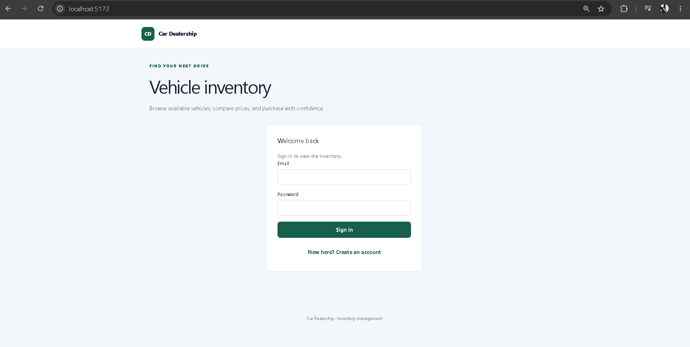
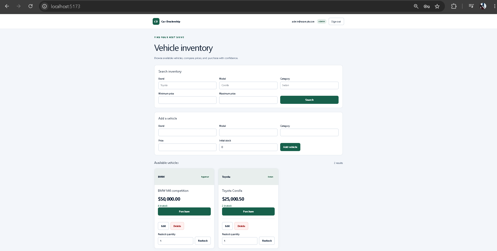
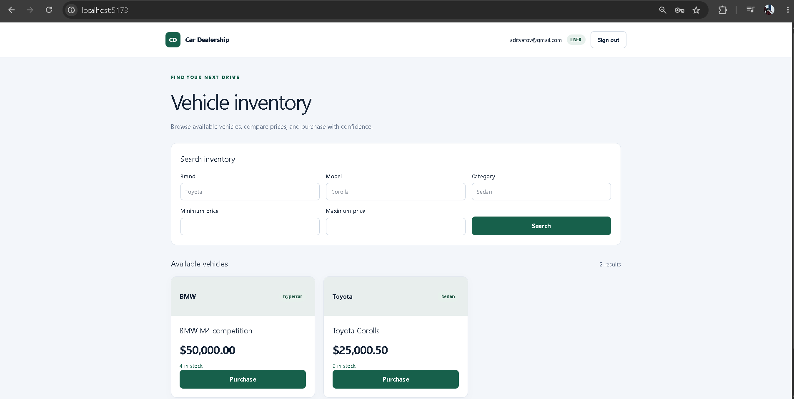

# Car Dealership Inventory System

A full-stack vehicle inventory application developed for the Incubyte TDD kata using TypeScript, Express, PostgreSQL, React, Vite, and Tailwind CSS.

Users can register, sign in, search inventory, and purchase vehicles. Administrators can create, edit, delete, and restock vehicles.

## Features

- User registration and login.
- Argon2id password hashing.
- JWT authentication with one-hour access tokens.
- Backend-enforced user and administrator permissions.
- Vehicle search by brand, model, category, and price range.
- Vehicle purchasing with atomic stock updates.
- Prevention of purchases when stock is zero.
- Administrator vehicle creation, editing, deletion, and restocking.
- Responsive interface with disabled purchase buttons for out-of-stock vehicles.
- SQL migrations with migration history and transactional rollback.
- Separate development and test databases.
- Automated tests and GitHub Actions quality checks.

## Permissions

| Operation            | Ordinary user | Administrator |
| -------------------- | ------------- | ------------- |
| Browse inventory     | Yes           | Yes           |
| Search inventory     | Yes           | Yes           |
| Purchase vehicles    | Yes           | Yes           |
| Create vehicles      | No            | Yes           |
| Edit vehicle details | No            | Yes           |
| Delete vehicles      | No            | Yes           |
| Restock vehicles     | No            | Yes           |

Public registration always creates an ordinary `USER` account. Administrator accounts are provisioned separately.

Vehicle editing updates brand, model, category, and price. Stock changes are handled through purchase and restock operations.

## Technology Stack

| Area                   | Technologies                                    |
| ---------------------- | ----------------------------------------------- |
| Frontend               | React, TypeScript, Vite, Tailwind CSS, CSS      |
| Backend                | Node.js, TypeScript, Express                    |
| Database               | PostgreSQL, parameterized SQL                   |
| Authentication         | JWT, Argon2id                                   |
| Validation             | Zod                                             |
| Backend testing        | Vitest, Supertest, PostgreSQL integration tests |
| Frontend testing       | Vitest, React Testing Library                   |
| Quality checks         | TypeScript, ESLint, Prettier                    |
| Continuous integration | GitHub Actions                                  |

## Repository Structure

```text
backend/
  migrations/           SQL schema migrations
  scripts/              Local migration command
  src/
    auth/               Authentication, authorization, and account services
    db/                 Migration runner
    vehicles/           Vehicle validation, repository, and routes
    app.ts              Express application
    server.ts           Development server and dependency wiring
  tests/
    helpers/            Test database safeguards
    integration/        HTTP and PostgreSQL integration tests
    unit/               Validation and service tests

frontend/
  src/
    App.tsx             Authentication and inventory interface
    styles.css          Application styling
    tests/              Component tests

.github/workflows/
  ci.yml                Automated quality checks

docs/
  screenshots/          Application screenshots
  TEST_REPORT.md        Verification evidence

PROMPTS.md              AI conversation records
README.md               Setup and application documentation
```

## Prerequisites

- Node.js **22.20.0**, matching `.node-version`.
- npm, tested locally with **10.9.3**.
- PostgreSQL **18**, running locally on port **5432**.
- Git.

The commands below use Windows PowerShell. On other platforms, use `npm` instead of `npm.cmd` and adjust file-copy and PostgreSQL executable paths.

## Local Setup

### 1. Clone and install dependencies

```powershell
git clone https://github.com/ahhdithya/car-dealership.git
cd car-dealership
npm.cmd ci
```

Run subsequent commands from the repository root unless otherwise specified.

### 2. Create development and test databases

Open PostgreSQL as the administrator:

```powershell
& "C:\Program Files\PostgreSQL\18\bin\psql.exe" -h localhost -p 5432 -U postgres -d postgres -W
```

If `psql` is on your PATH, you can use:

```powershell
psql -h localhost -p 5432 -U postgres -d postgres -W
```

For a fresh installation, run these commands inside `psql`:

```sql
CREATE ROLE dealership_dev_user LOGIN NOSUPERUSER NOCREATEDB NOCREATEROLE;
\password dealership_dev_user

CREATE DATABASE dealership_dev OWNER dealership_dev_user;

CREATE ROLE dealership_test_user LOGIN NOSUPERUSER NOCREATEDB NOCREATEROLE;
\password dealership_test_user

CREATE DATABASE dealership_test OWNER dealership_test_user;

\q
```

The `\password` commands prompt for passwords. Choose separate passwords for the development and test accounts.

Skip creation of databases and roles that already exist.

The application requires these exact local database names and accounts:

| Purpose     | Database          | Account                |
| ----------- | ----------------- | ---------------------- |
| Development | `dealership_dev`  | `dealership_dev_user`  |
| Tests       | `dealership_test` | `dealership_test_user` |

Neither application account should be a PostgreSQL superuser.

### 3. Configure the development environment

Copy the example configuration:

```powershell
Copy-Item backend/.env.example backend/.env
```

Edit `backend/.env`:

```dotenv
NODE_ENV=development
PGHOST=localhost
PGPORT=5432
PGDATABASE=dealership_dev
PGUSER=dealership_dev_user
PGPASSWORD="YOUR_DEVELOPMENT_DATABASE_PASSWORD"
JWT_SECRET=YOUR_64_CHARACTER_HEXADECIMAL_KEY
```

Generate a private JWT signing key:

```powershell
node -e "console.log(require('node:crypto').randomBytes(32).toString('hex'))"
```

Copy the generated value into `JWT_SECRET`.

The database password belongs to `dealership_dev_user`. It is separate from passwords used to sign in through the website.

Do not commit or share the generated key or environment files.

### 4. Configure the test environment

Create `backend/.env.test`:

```dotenv
NODE_ENV=test
PGHOST=localhost
PGPORT=5432
PGDATABASE=dealership_test
PGUSER=dealership_test_user
PGPASSWORD="YOUR_TEST_DATABASE_PASSWORD"
```

Both `.env` and `.env.test` are ignored by Git.

Integration tests validate the configured database and actual connection identity before creating isolated test schemas.

### 5. Apply development migrations

```powershell
npm.cmd run db:migrate --workspace=@car-dealership/backend
```

This creates the users and vehicles tables in the development database.

Applied migration names are recorded in `schema_migrations`. Running the command again skips migrations that have already been applied.

Integration tests prepare their own schemas in the test database, so development migrations do not need to be manually applied there.

### 6. Start the backend

In one terminal:

```powershell
npm.cmd run dev --workspace=@car-dealership/backend
```

Expected startup message:

```text
API listening at http://127.0.0.1:3000
```

### 7. Start the frontend

In a second terminal:

```powershell
npm.cmd run dev --workspace=@car-dealership/frontend
```

Open:

```text
http://localhost:5173
```

The frontend development server proxies `/api` requests to the backend.

Keep only one backend process on port `3000` and one frontend process on port `5173`.

### 8. Register and sign in

Use the registration screen to create an account, then sign in.

Registration passwords must contain between 12 and 128 characters. Email addresses are trimmed and lowercased; passwords are preserved exactly.

A fresh database has no vehicles. Provision an administrator to add inventory.

## Provisioning a Development Administrator

Register `admin@example.com` through the website with a password of your choice.

Then run:

```powershell
& "C:\Program Files\PostgreSQL\18\bin\psql.exe" -h localhost -p 5432 -U dealership_dev_user -d dealership_dev -W -c "UPDATE public.users SET role = 'ADMIN' WHERE email = 'admin@example.com' RETURNING id, email, role;"
```

Enter the development database account password when prompted.

Expected result: one updated row with role `ADMIN`.

Sign out of the website and sign in again. A new login is required because the access token contains the account role.

Keep a separate ordinary-user account to verify user permissions.

## Using the Application

### Ordinary users

1. Register or sign in.
2. Browse the inventory.
3. Search by brand, model, category, or price range.
4. Select **Purchase** to purchase one unit.
5. The displayed inventory refreshes after a successful purchase.
6. Purchase buttons are disabled when stock reaches zero.

### Administrators

Administrators can also:

- Add vehicles with an initial stock quantity.
- Edit vehicle details and prices.
- Delete vehicles after confirmation.
- Restock vehicles with a positive integer quantity.

### Search behavior

- Brand and model searches use case-insensitive partial matching.
- Category uses case-insensitive exact matching.
- Multiple filters are combined.
- Minimum and maximum prices are inclusive.
- Leave unused filters blank.
- Clear the fields and select **Search** to return to the full inventory.

## API Reference

All vehicle endpoints require:

```http
Authorization: Bearer <access-token>
```

| Method | Endpoint                     | Access        | Success response               |
| ------ | ---------------------------- | ------------- | ------------------------------ |
| POST   | `/api/auth/register`         | Public        | `201`, `{ user }`              |
| POST   | `/api/auth/login`            | Public        | `200`, `{ accessToken, user }` |
| GET    | `/api/vehicles`              | Authenticated | `200`, `{ vehicles }`          |
| GET    | `/api/vehicles/search`       | Authenticated | `200`, `{ vehicles }`          |
| POST   | `/api/vehicles`              | ADMIN         | `201`, `{ vehicle }`           |
| PUT    | `/api/vehicles/:id`          | ADMIN         | `200`, `{ vehicle }`           |
| DELETE | `/api/vehicles/:id`          | ADMIN         | `204`, no response body        |
| POST   | `/api/vehicles/:id/purchase` | Authenticated | `200`, `{ vehicle }`           |
| POST   | `/api/vehicles/:id/restock`  | ADMIN         | `200`, `{ vehicle }`           |

### Registration and login

```json
{
  "email": "user@example.com",
  "password": "Example password 123!"
}
```

Public account responses exclude password hashes.

### Create a vehicle

```json
{
  "make": "Toyota",
  "model": "Corolla",
  "category": "Sedan",
  "price": "25000.50",
  "stock": 3
}
```

`price` must be a decimal string. Omitted initial stock defaults to zero.

### Edit a vehicle

```json
{
  "make": "Toyota",
  "model": "Corolla",
  "category": "Sedan",
  "price": "27000.50"
}
```

All four fields are required. Do not include `stock`.

### Restock a vehicle

```json
{
  "quantity": 2
}
```

Quantity must be a positive integer.

### Search inventory

```text
/api/vehicles/search?make=toy&category=sedan&minPrice=20000&maxPrice=30000
```

Supported query parameters:

- `make`
- `model`
- `category`
- `minPrice`
- `maxPrice`

### Error responses

Handled application errors use this structure:

```json
{
  "error": {
    "code": "OUT_OF_STOCK",
    "message": "Vehicle is out of stock."
  }
}
```

| Status | Meaning                                                        |
| ------ | -------------------------------------------------------------- |
| 400    | Invalid input                                                  |
| 401    | Missing/invalid authentication or invalid login credentials    |
| 403    | Insufficient permissions                                       |
| 404    | Vehicle not found                                              |
| 409    | Duplicate email, out-of-stock vehicle, or stock limit exceeded |
| 500    | Unexpected server failure                                      |

## Data Integrity and Authentication

- Passwords are hashed using Argon2id.
- JWT verification checks signature, algorithm, issuer, audience, expiration, and account claims.
- Public registration cannot assign administrator privileges.
- Authorization is enforced on protected backend routes.
- SQL queries use parameters for user-supplied values.
- Database constraints enforce required fields and valid account/vehicle values.
- Purchase checks and stock reduction occur in one conditional SQL update.
- Restocking increments existing stock and checks the supported integer limit.
- Vehicle-detail edits leave stock unchanged.
- Development and test database identities are checked explicitly.

## Testing

Run from the repository root:

```powershell
npm.cmd run format:check
npm.cmd run lint
npm.cmd run typecheck --workspace=@car-dealership/backend
npm.cmd run test --workspace=@car-dealership/backend
npm.cmd run test --workspace=@car-dealership/frontend
npm.cmd run build --workspace=@car-dealership/frontend
```

The frontend build includes its TypeScript check.

Backend integration tests require PostgreSQL and a valid `backend/.env.test`.

### Focused test commands

```powershell
npm.cmd run test --workspace=@car-dealership/backend -- tests/integration/vehicles.repository.test.ts
npm.cmd run test --workspace=@car-dealership/frontend -- src/tests/App.test.tsx
```

### Test scope

Automated tests cover:

- Database connection safeguards and migrations.
- Registration and login validation.
- Password hashing and verification.
- JWT signing and verification.
- Authentication and administrator permissions.
- User persistence and duplicate-email rejection.
- Vehicle persistence and search.
- Purchase, restock, edit, and delete behavior.
- Frontend sign-in rendering and inventory loading.
- Disabled purchase controls for out-of-stock vehicles.

See [the test report](docs/TEST_REPORT.md) for final test totals, the tested commit, and verification evidence.

## Continuous Integration

[GitHub Actions runs](https://github.com/ahhdithya/car-dealership/actions)

The CI workflow:

1. Checks out the repository.
2. Uses the Node.js version specified in `.node-version`.
3. Installs locked dependencies with `npm ci`.
4. Starts PostgreSQL 18.
5. Creates a dedicated test database and account.
6. Writes disposable test configuration.
7. Checks formatting and lint.
8. Checks backend types and runs backend tests.
9. Runs frontend tests.
10. Builds the frontend and checks its types.

CI credentials are disposable test values and are unrelated to local development credentials.

## Screenshots

### Sign In



### Administrator Inventory



### Ordinary-User Inventory



### Mobile View


## Development Approach

Backend features were generally developed incrementally:

1. Write a behavioral test.
2. Run it and inspect the expected failure.
3. Implement the behavior.
4. Run focused tests.
5. Run quality checks and the full test suite before completing a batch.
6. Commit and verify through CI.

The commit history records Red and Green steps for many backend features.

The frontend was implemented as a larger batch with focused component tests and manual browser verification. Not every change used a separate Red/Green cycle.

Later testing prioritized core workflows, authorization, and stock integrity to keep implementation focused.

## My AI Usage

### Tools Used

ChatGPT assisted throughout the project.

### How AI Was Used

- Interpreting requirements and discussing implementation choices.
- Planning the architecture and technology stack.
- Guiding Windows, npm workspace, and PostgreSQL setup.
- Suggesting tests, SQL migrations, and implementation code.
- Developing authentication, authorization, and inventory operations.
- Building the React frontend and responsive styling.
- Diagnosing TypeScript, lint, test, and development-server errors.
- Drafting setup instructions, API documentation, and submission material.

### Developer Responsibilities

I applied changes locally, executed commands, reviewed test output, and performed manual browser checks.

AI-generated suggestions were checked through compilation, linting, automated tests, and manual verification. Actual command results were used to distinguish successful implementation from expected behavior.

### Reflection

AI assistance accelerated implementation and helped divide the work into smaller, verifiable steps. It also required careful review.

For example, an initial price-normalization test incorrectly expected `25000.50` for an input of `25000`. The expectation was corrected to `25000.00`. Other issues, including test-helper scope and lint errors, were identified through local checks and corrected.

### Conversation Records

Actual conversation links or exported transcripts are recorded in [PROMPTS.md](PROMPTS.md).

## Known Limitations

- Startup configuration is intended for local development.
- No live deployment is included.
- The frontend production build requires an appropriate API proxy and production configuration when deployed.
- `vite preview` alone is not a complete production deployment.
- Access tokens expire after one hour.
- Tokens are kept in browser memory; refreshing the page requires signing in again.
- Signing out clears the browser session but does not revoke an already issued token on the server.
- Role changes require a fresh login to appear in a new token; existing tokens retain their claims until expiration.
- Payment processing, carts, and order history are outside this implementation.
- Browser workflows were checked manually; no Playwright suite is included.
- No coverage percentage or dedicated concurrent-client stress-test result is claimed.

## Troubleshooting

### Port already in use

If the backend reports `EADDRINUSE`, another process is already using port `3000`. Stop the existing development server before starting another instance.

### Database authentication failed

Check that `PGPASSWORD` matches the password for the configured PostgreSQL account. Website login passwords and PostgreSQL account passwords are separate.

### Missing database tables

Run:

```powershell
npm.cmd run db:migrate --workspace=@car-dealership/backend
```

### Administrator controls are missing

Confirm that the account has role `ADMIN` in the development database, then sign out and sign in again.

### Inventory is empty

A fresh database contains no vehicles. Sign in as an administrator and add inventory, or clear active search filters.

### API requests fail from the frontend

Confirm that both development servers are running and open the application through `http://localhost:5173`.

## Repository

[GitHub repository](https://github.com/ahhdithya/car-dealership)
